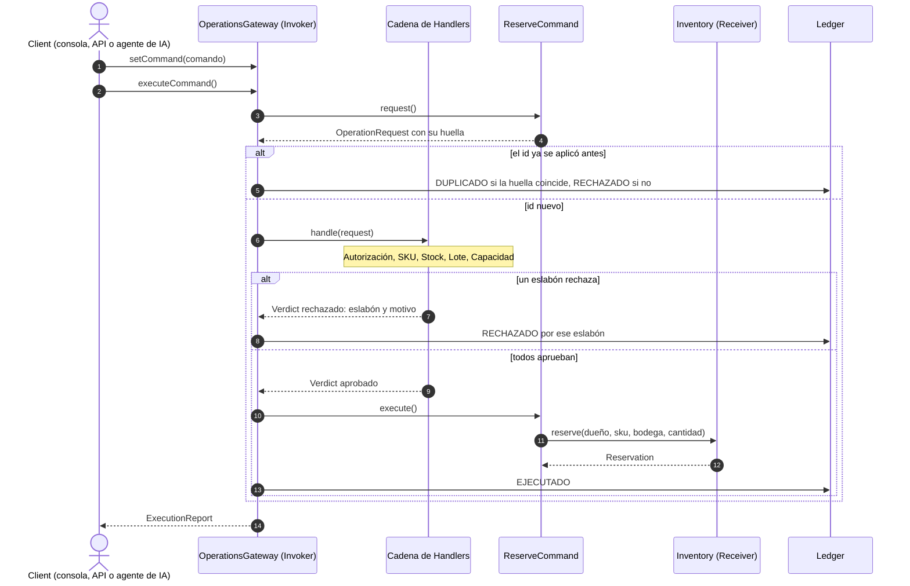
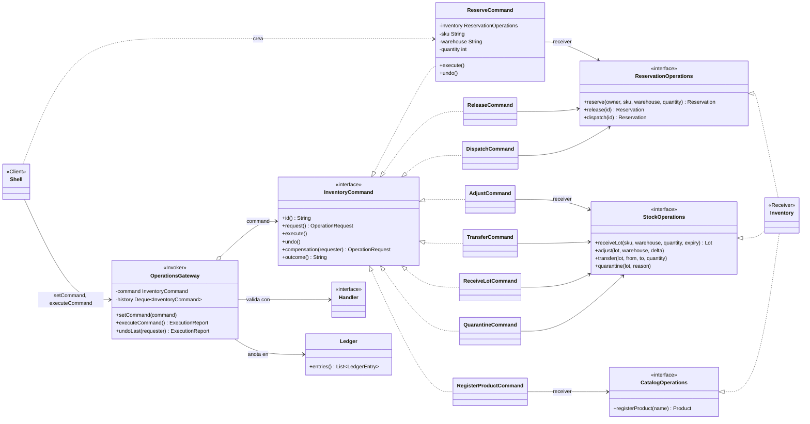
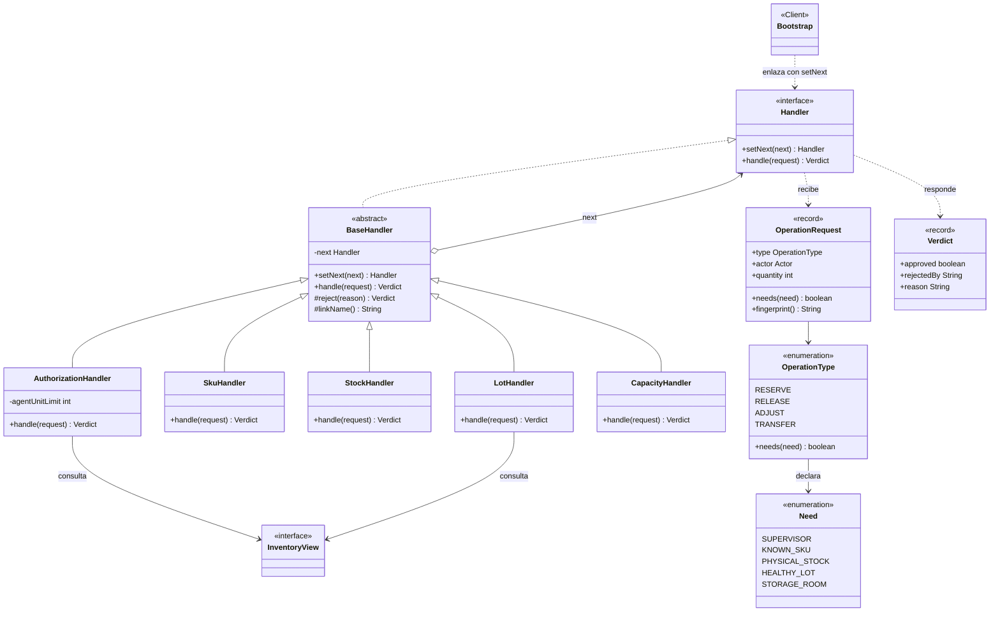

# Smart Inventory · Command + Chain of Responsibility

[](https://github.com/gasparinxd/smart-inventory-command-chain/actions/workflows/ci.yml)

Núcleo de inventario para el Smart Inventory de LOGISTPULSE, escrito en Java 17. Toda operación sobre el stock entra por una sola puerta y sigue siempre el mismo camino:

1. se convierte en un **comando** (patrón Command),
2. pasa por una **cadena de validación** (patrón Chain of Responsibility),
3. se ejecuta sobre el inventario y
4. queda escrita en un **ledger**.

Es la idea de la presentación del curso: *"Command + Chain ↔ Guardrails: humanos y agentes de IA pasan por la misma validación y dejan registro"*.

## Probarlo en un minuto

Hace falta **Java 17 o superior** y **Maven 3.9 o superior**.

```bash
mvn verify
```

```bash
java -jar target/smart-inventory-command-chain-1.0.0.jar demo
```

```bash
java -jar target/smart-inventory-command-chain-1.0.0.jar
```

- `mvn verify` compila, corre las 138 pruebas (JUnit) y arma el `.jar`.
- Con `demo` se ve un recorrido automático por todo lo que hace el sistema.
- Sin argumentos abre la consola interactiva; `ayuda` lista los comandos.

El sistema arranca con seis productos y ocho lotes repartidos en tres bodegas (QUITO, GUAYAQUIL y CUENCA). Uno de los lotes ya está en cuarentena y CUENCA está casi llena, para poder provocar rechazos desde el primer momento.

Los diagramas de este documento están también como imagen en la carpeta [`docs/`](docs).

## El camino de un comando

<!-- diagrama: docs/flujo-comando.png -->


El invoker (`OperationsGateway`) no sabe qué hace cada comando. Le pide que se describa como `OperationRequest` y con esa descripción hace tres cosas: comprobar la idempotencia, pasarla por la cadena y anotarla en el ledger. Por eso sirve igual para los ocho comandos.

## Patrón Command

Sigue la estructura de Refactoring.Guru: un **Invoker** con el campo `command`, `setCommand()` y `executeCommand()`; una interfaz **Command**; los **ConcreteCommands**, que reciben el receptor y sus parámetros en el constructor; el **Receiver** y el **Client**.

| Rol | Clase | Qué hace |
|---|---|---|
| Command | `command.InventoryCommand` | `execute()`, `undo()` y la descripción de la operación (`request()`) y de su inversa (`compensation()`) |
| ConcreteCommand | `ReserveCommand`, `ReleaseCommand`, `AdjustCommand`, `TransferCommand`, `DispatchCommand`, `ReceiveLotCommand`, `RegisterProductCommand`, `QuarantineCommand` | Guarda el receptor y los parámetros; `execute()` delega en el receptor |
| Receiver | `inventory.Inventory` | La lógica real del stock. Los comandos lo ven a través de tres interfaces pequeñas |
| Invoker | `gateway.OperationsGateway` | `setCommand()`, `executeCommand()`, `undoLast()`; historial LIFO |
| Historial | `gateway.Ledger` | `LedgerEntry` es un `record` con `Instant`, actor, resultado y huella |
| Client | `app.Shell`, `app.DemoScript`, `app.SeedData` | Crean los comandos y se los dan al invoker |

<!-- diagrama: docs/command-clases.png -->


```java
InventoryCommand reserva = new ReserveCommand("WEB-501", tiendaWeb, inventory, "ABAR-ATU-001", "GUAYAQUIL", 20);
gateway.setCommand(reserva);
ExecutionReport respuesta = gateway.executeCommand();
// [EJECUTADO] WEB-501: reserva RSV-0002 de tienda-web: 20 u de ABAR-ATU-001 en GUAYAQUIL [20 de L-0006]
```

### Los comandos y sus inversos

La presentación dice que los comandos "se compensan con su inverso". Aquí deshacer no borra nada: aplica la operación contraria, que también pasa por la cadena y también queda en el ledger.

| Comando | Qué hace | Cómo se deshace | Quién puede |
|---|---|---|---|
| `RegisterProductCommand` | Identifica el producto por su nombre y le asigna SKU | Retira el producto (si aún no tiene lotes) | cualquiera |
| `ReceiveLotCommand` | Entra un lote nuevo a una bodega | Anula la recepción (si el lote no se ha tocado) | cualquiera |
| `ReserveCommand` | Aparta unidades; si un lote no alcanza, reparte entre varios | Libera esa reserva | cualquiera |
| `ReleaseCommand` | Devuelve al stock libre las unidades de una reserva | Vuelve a apartar las mismas unidades | el dueño o un supervisor |
| `DispatchCommand` | Las unidades reservadas salen de la bodega | Devolución: regresan y la reserva se reactiva | el dueño o un supervisor |
| `AdjustCommand` | Suma o resta por conteo, merma o hallazgo | El mismo ajuste con el signo contrario | solo supervisor |
| `TransferCommand` | Mueve unidades de un lote entre bodegas | La transferencia de regreso | cualquiera |
| `QuarantineCommand` | Bloquea un lote, o lo desbloquea | La acción contraria | bloquear: cualquiera; desbloquear: supervisor |

### Identificar un producto

Al registrar un producto solo se escribe el nombre. `ProductClassifier` busca palabras clave (sin importar tildes, mayúsculas ni plurales) para decidir la familia, y el catálogo arma el código como `FAMILIA-ABC-NNN`.

```
sofia> registrar Laptop HP Pavilion 15
[EJECUTADO] CMD-0001: "Laptop HP Pavilion 15" identificado como Electrónica con el código ELEC-LAP-002
sofia> registrar Jarabe para la tos 120 ml
[EJECUTADO] CMD-0002: "Jarabe para la tos 120 ml" identificado como Farmacia con el código FARM-JAR-002
```

Familias: Electrónica (`ELEC`), Refrigerados (`REFR`), Farmacia (`FARM`), Abarrotes (`ABAR`), Limpieza (`LIMP`), Ferretería (`FERR`) y General (`GENE`). Refrigerados y Farmacia exigen fecha de vencimiento al recibir un lote.

## Patrón Chain of Responsibility

Sigue la estructura de Refactoring.Guru: la interfaz **Handler** con `setNext()` y `handle()`; un **BaseHandler** que guarda `next` y reenvía; los **ConcreteHandlers**, que revisan lo suyo y si todo está bien llaman a `super.handle(request)`; y el **Client**, que los enlaza.

| Rol | Clase | Qué revisa |
|---|---|---|
| Handler | `chain.Handler` | `setNext(next)` y `handle(request)` |
| BaseHandler | `chain.BaseHandler` | Guarda `next`. Sin siguiente, la solicitud queda aprobada |
| ConcreteHandler | `AuthorizationHandler` | Hay un actor; tiene el rol que la operación pide; un agente de IA no pasa de 100 u por operación; una reserva solo la toca su dueño o un supervisor |
| ConcreteHandler | `SkuHandler` | El SKU existe en el catálogo |
| ConcreteHandler | `StockHandler` | La cantidad tiene sentido y hay unidades físicas libres para lo que sale |
| ConcreteHandler | `LotHandler` | El lote existe; no está vencido ni en cuarentena; la fecha de vencimiento es coherente |
| ConcreteHandler | `CapacityHandler` | Hay espacio en la bodega que recibe y en la zona de despacho |
| Client | `app.Bootstrap` | Crea los eslabones y los enlaza con `setNext()` |

<!-- diagrama: docs/chain-clases.png -->


```java
Handler authorization = new AuthorizationHandler(inventory, AGENT_UNIT_LIMIT);
Handler sku = new SkuHandler(inventory);
Handler stock = new StockHandler(inventory);
Handler lot = new LotHandler(inventory);
Handler capacity = new CapacityHandler(inventory);

authorization.setNext(sku);
sku.setNext(stock);
stock.setNext(lot);
lot.setNext(capacity);
```

### Una sola cadena para todas las operaciones

No hay una cadena por tipo de operación ni un `switch` dentro de los eslabones. Cada operación **declara** en `OperationType` qué verificaciones necesita (`Need`), y cada eslabón atiende solo las suyas y deja pasar el resto:

| Operación | Autorización | SKU | Stock | Lote | Capacidad |
|---|---|---|---|---|---|
| registrar producto | actor válido | | | | |
| recibir lote | actor válido | existe | cantidad > 0 | vencimiento coherente | espacio en la bodega |
| reservar | actor válido | existe | cantidad > 0 y unidades libres | unidades vigentes y sin cuarentena | zona de despacho |
| liberar reserva | dueño o supervisor | | | | |
| despachar | dueño o supervisor | | | lotes de la reserva sanos | |
| ajustar | supervisor | | distinto de 0; si resta, unidades libres | el lote existe | si suma, espacio |
| transferir | actor válido | | cantidad > 0 y unidades libres | existe, vigente y sin cuarentena | espacio en el destino |
| poner en cuarentena | actor válido | | | el lote existe | |
| levantar cuarentena | supervisor | | | el lote existe | |

Agregar una operación es agregar una constante al `enum` con sus necesidades; agregar una validación es agregar un eslabón. En ninguno de los dos casos se tocan los eslabones que ya existen (`GuardrailChainTest.aNewLinkCanBeAddedWithoutTouchingTheExistingOnes`).

Un rechazo no es una excepción: la cadena devuelve un `Verdict` que dice **qué eslabón** detuvo la solicitud y **por qué**.

```
[RECHAZADO por Autorización] D-401: sofia es operador; para ajustar stock hace falta un supervisor
[RECHAZADO por SKU] D-403: el SKU ELEC-TV-999 no existe en el catálogo
[RECHAZADO por Stock] D-404: en QUITO hay 40 u libres de ELEC-LAP-001 y se necesitan 500
[RECHAZADO por Lote] D-405: de las 150 u libres de FARM-PAR-001 en GUAYAQUIL solo 0 están en lotes vigentes y sin cuarentena; se pidieron 50
[RECHAZADO por Capacidad] D-406: CUENCA almacena 100 de 120 u; no caben 30 más
```

## Guardrails: lo que el sistema no deja pasar

Cada fila tiene una prueba que la respalda.

| Intento | Resultado | Prueba |
|---|---|---|
| Reenviar un comando con el mismo id y los mismos datos | `DUPLICADO`: no se aplica dos veces | `retryingTheSameCommandDoesNotApplyItTwice` |
| Reusar un id con otros datos (misma reserva, otra cantidad) | `RECHAZADO por Idempotencia`: no es un falso OK | `reusingAnIdWithDifferentContentIsRejectedNotSilentlyAccepted` |
| Reintentar un comando que antes fue rechazado | Se evalúa de nuevo: un rechazo no gasta el id | `aRejectedAttemptDoesNotConsumeTheId` |
| Liberar o despachar la reserva de otro actor | `RECHAZADO por Autorización`, salvo un supervisor | `onlyTheOwnerOrASupervisorActsOnAReservation` |
| Un agente de IA pide mover más de 100 u | `RECHAZADO por Autorización`; la misma cantidad pedida por una persona pasa | `aiAgentsPassTheSameChainPlusAUnitLimit` |
| Deshacer el comando de otro actor | `RECHAZADO`, salvo un supervisor | `onlyTheAuthorOrASupervisorCanUndoACommand` |
| Deshacer algo que ya no se puede deshacer | `RECHAZADO` y el comando **sigue** en el historial | `theInverseOperationAlsoPassesTheChainAndAFailedUndoKeepsTheCommand` |
| Despachar una reserva cuyo lote venció | `RECHAZADO por Lote` | `expiredStockCannotBeReservedMovedOrDispatched` |
| Llamar al inventario directo, sin invoker ni cadena | `InventoryRuleViolation`: nada queda en negativo | `stockNeverGoesNegative`, `anAdjustmentCannotEatReservedUnits` |

Dos detalles sobre el último punto. Las reglas no viven solo en la cadena: `Inventory` vuelve a comprobarlas antes de tocar nada, y los cambios de cantidades pasan por `StockPosition`, que mantiene `0 <= reservado <= físico`. Y los objetos del dominio (`Lot`, `Reservation`) solo se pueden modificar desde el paquete del inventario; hacia afuera no tienen métodos que cambien su estado.

## Una sesión en la consola

```
sofia> #PED-1 reservar REFR-YOG-001 QUITO 100
[EJECUTADO] PED-1: reserva RSV-0001 de sofia: 100 u de REFR-YOG-001 en QUITO [60 de L-0002 + 40 de L-0003]
sofia> #PED-1 reservar REFR-YOG-001 QUITO 100
[DUPLICADO] PED-1: ya se había aplicado y no se repite. Resultado original: reserva RSV-0001 de sofia: ...
sofia> #PED-1 reservar REFR-YOG-001 QUITO 5
[RECHAZADO por Idempotencia] PED-1: el id PED-1 ya se usó para una operación con otros datos
sofia> actor pulse-ai
Ahora trabajas como pulse-ai (agente de IA, operador).
pulse-ai> liberar RSV-0001
[RECHAZADO por Autorización] CMD-0001: la reserva RSV-0001 es de sofia; solo sofia o un supervisor pueden actuar sobre ella
pulse-ai> actor mateo
Ahora trabajas como mateo (persona, supervisor).
mateo> deshacer
[DESHECHO] PED-1: se compensó con: liberar la reserva RSV-0001
```

Otros comandos útiles: `stock`, `bodegas`, `reservas`, `ledger`, `reintentar` (reenvía el último comando con el mismo id) y `avanzar 5` (adelanta la fecha del sistema cinco días para ver cómo un lote vence).

## Decisiones de diseño

- **Una responsabilidad por clase.** Cada eslabón revisa una sola cosa. El invoker orquesta y audita, pero no valida ni conoce el stock. `Inventory` hace las operaciones; identificar productos y armar SKU es de `ProductClassifier` y `Catalog`.
- **Abierto a extensión.** Un comando nuevo implementa `InventoryCommand`; una validación nueva extiende `BaseHandler`; una operación nueva declara sus `Need`. Nada de eso modifica clases existentes.
- **Sustitución.** Todos los eslabones cumplen el mismo contrato: responden con un `Verdict` y nunca lanzan una excepción por un rechazo. El invoker trata igual a los ocho comandos.
- **Interfaces pequeñas.** Los comandos no reciben el `Inventory` completo sino lo que usan: `ReservationOperations`, `StockOperations` o `CatalogOperations`. Los eslabones reciben `InventoryView`, que es de solo lectura.
- **Depender de abstracciones.** El invoker recibe un `Handler` y un `Ledger` por constructor. Las clases concretas se crean y se conectan en un único lugar, `Bootstrap`. El reloj (`Clock`) también se inyecta, así las pruebas fijan la fecha y la consola puede adelantarla.

## Límites conocidos

Es un prototipo de curso, no un sistema en producción:

- Todo vive en memoria. No hay base de datos y los datos se pierden al cerrar.
- No es seguro para varios hilos. El invoker, el inventario y el ledger asumen un solo hilo.
- El ledger y el historial crecen sin límite.
- Deshacer es estrictamente LIFO: solo el último comando aplicado.
- La reserva reparte entre lotes con un criterio fijo (vence primero, sale primero). La política intercambiable está en el otro proyecto de la entrega, con Strategy.
- Los actores son una lista fija; no hay autenticación.

## Estructura

```
src/main/java/edu/usfq/smartinv/
├── actors/      Actor, ActorKind, Role
├── inventory/   Inventory (receiver), interfaces de operación, InventoryView,
│                Lot, StockPosition, Reservation, Warehouse, Product, Category,
│                ProductClassifier, Catalog, InventoryRuleViolation
├── chain/       Handler, BaseHandler, los 5 eslabones, OperationRequest,
│                OperationType, Need, Verdict
├── command/     InventoryCommand y los 8 comandos
├── gateway/     OperationsGateway (invoker), Ledger, LedgerEntry, ExecutionReport, Outcome
└── app/         Main, Bootstrap, Shell, DemoScript, SeedData, Reports, AdjustableClock
src/test/java/   138 pruebas JUnit
docs/            diagramas en PNG
.github/         CI: compila y prueba con Java 17 y 21
```

## Referencias

- Refactoring.Guru: [Command](https://refactoring.guru/es/design-patterns/command) y [Chain of Responsibility](https://refactoring.guru/es/design-patterns/chain-of-responsibility).
- Presentación del curso: *Patrones de comportamiento en el Smart Inventory de LOGISTPULSE*.
- Ejemplo de referencia del curso: [luisburgos/design-patterns](https://github.com/luisburgos/design-patterns).
